<picture>
  <source media="(prefers-color-scheme: dark)" srcset="assets/banner-dark.svg">
  
</picture>

 

Hi, I'm Edgar. I'm a systems engineer from Guadalajara, and I mostly build web apps for small businesses and schools: the kind of internal tools that replace a pile of spreadsheets.

### Right now

Most of my time goes into a management system for a K–9 school. Their report cards used to come out of an Excel workbook full of macros; the app now generates them as PDFs that match the old layout exactly. Teachers get their own space to enter grades and upload weekly lesson plans, coordinators review them, and each role only sees what it should. It's built for about 30 staff and goes fully live in January.

It's Node, Express and SQLite, with Puppeteer for the PDFs. It runs on a Proxmox server I set up myself, behind a Cloudflare Tunnel, with nightly backups.

### Other things

- A quoting system for a medical supply distributor, written in Python. It's on its second version.
- My homelab: Proxmox with one container per app, Tailscale for anything that shouldn't be public.
- A [landing page demo](https://edgarpichardob.github.io/Demo-Lanfing-Avicultura/) for a poultry business.

Most of my work is in private repos, which is why this profile looks quiet.

### Reach me

[Edgar.PichardoB@outlook.com](mailto:Edgar.PichardoB@outlook.com) or [LinkedIn](https://linkedin.com/in/EdgarPichardoB).
